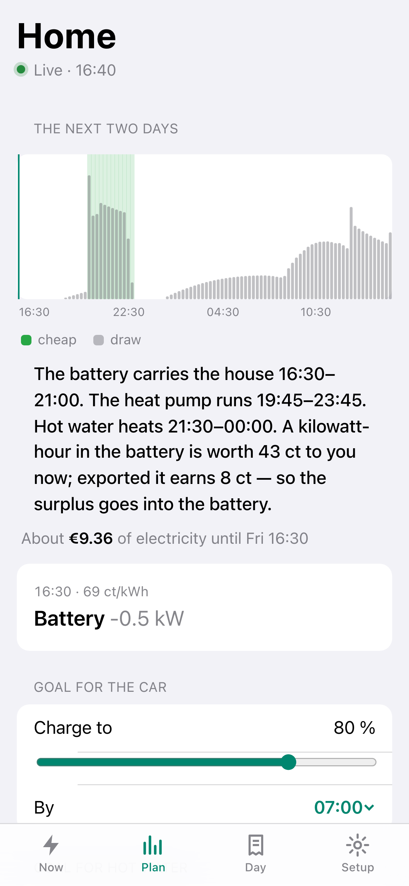

<h1 align="center">⚡ ems</h1>

<p align="center">
  <strong>Energy management for homes, buildings and industrial sites on the German grid.</strong>
</p>

<p align="center">
  <a href="https://hupe1980.github.io/ems"></a>
  <a href="https://github.com/hupe1980/ems/actions/workflows/ci.yml"></a>
  <a href="#-licence"></a>
  
  
</p>

Try the [five-minute peak challenge](https://hupe1980.github.io/ems/peak-challenge/) in your browser. Choose when to start a battery, then check your projection against the original meter close.

Compare one-phase and three-phase charging in the [household solar simulator](https://hupe1980.github.io/ems/solar-charging/). To compare outlet delivery with whole-house import during a charger interruption, run `cargo run -p hemsd --features house -- ev-departure`.

## Choose an edge system

| System | What you can run | Local demo |
|---|---|---|
| [Household · hemsd](services/hemsd) | Manage a home battery, EV, heat pump and hot water within grid limits. Pre-alpha, without EEBUS certification. | `cargo run -p hemsd -- demo` · [8080](http://127.0.0.1:8080/) |
| [Building · bemsd](services/bemsd) | See a BACnet zone sensor reserve heating capacity and compare both OCPP stations with a KNX feeder meter. Compare community allocation keys with `bemsd community`. Synthetic data. | `cargo run -p bemsd -- demo` · [8081](http://127.0.0.1:8081/) |
| [Industrial · cemsd](services/cemsd) | Compare battery dispatch times, review an import trace offline in HTML or JSON, or replay an aggregator request with the optional OpenADR simulation. | `cargo run -p cemsd -- demo` · [8082](http://127.0.0.1:8082/) |

Run these commands from the workspace root with Rust 1.99. Building `hemsd` also requires CMake and a C++ compiler for HiGHS.

<p align="center">
  
  
  
</p>
<p align="center"><a href="site/static/media/walkthrough.mp4">▶ Household demo walkthrough</a></p>

## Run a household gateway

For a new installation, start the gateway with an empty or missing configuration file:

```sh
cargo run -p hemsd -- run --config house.toml
```

Open the local address printed by the gateway and sign in with its access code. Setup walks you through identifying a SunSpec connection meter and reviewing the installation settings before activation.

For an existing installation, start with the [example configuration](services/hemsd/hemsd.example.toml). Set the asset names, driver addresses and storage paths for your installation.

```sh
cargo run -p hemsd -- run --check --config /etc/hems/hemsd.toml
cargo run -p hemsd -- run --config /etc/hems/hemsd.toml
```

On a running gateway, `hemsd doctor --config /etc/hems/hemsd.toml` checks device responses and pairing. With local measurement history enabled, **Day** shows the observed range and sample count for a selected quarter hour. [Installation guide](https://hupe1980.github.io/ems/docs/getting-started/) · [Household UI](https://hupe1980.github.io/ems/docs/household/) · [Optional Matter appliance reader](services/hemsd/README.md#matter-appliance-power)

## Workspace

The [crates](crates) implement grid rules, tariffs, forecasting, scheduling, device protocols, simulation and fleet interfaces. The seven [fleet services](https://hupe1980.github.io/ems/docs/services/) handle prices, weather, evidence, enrolment, reporting and advisory findings. The [operator desk](services/fleetd/README.md#operator-desk) shows when a gateway last checked in and when it last observed its feeder. The [household portal](services/portald/README.md) shows daily energy history and simulated charging receipts. Both browser interfaces support [OIDC sign-in](deploy/oidc/README.md).

Build the site with `just site-build` (Rust via rustup, Node, Python 3.11+ and Zola). The build embeds the choices evaluated by `ems-sim` and `ems-device`, compares the Wasm exports with native results, and verifies the generated site. Preview it with `just site`.

## ✅ Quality

1 472 tests. `just ci` runs formatting, Clippy with warnings as errors, a purity
check that keeps clocks and sockets out of the domain crates, the whole suite,
the workspace guards, `cargo-deny` and the docs. Workspace guards include:

- `check-citations` — 465 citations across five document families; all 465 of them against an index of primary sources resolve, or the build fails.
- `check-wire` — the 162 quantities and instants, each of which becomes money or evidence, say how they travel.
- `check-deps-used` — 322 declared dependencies, every one reached from source.
- `check-actions` — every GitHub Action pinned by commit.

Run `just house-meter-trial` to reconcile the meter and bill across winter and both Berlin clock changes. Run `just house-storage-trial` to verify gateway-issued battery setpoints, measured AC delivery and timed release over Modbus TCP.

Regulatory citations identify a decision, annex and clause, for example `[BK6-22-300 A1 4.5.2]`. See the [threat model](THREAT_MODEL.md) for trust boundaries and deployment assumptions.

## 📄 Licence

MIT OR Apache-2.0, at your option.

ems is not affiliated with the Bundesnetzagentur, the BDEW, the EEBus Initiative
or the VDE. Regulatory documents are cited, never redistributed.
