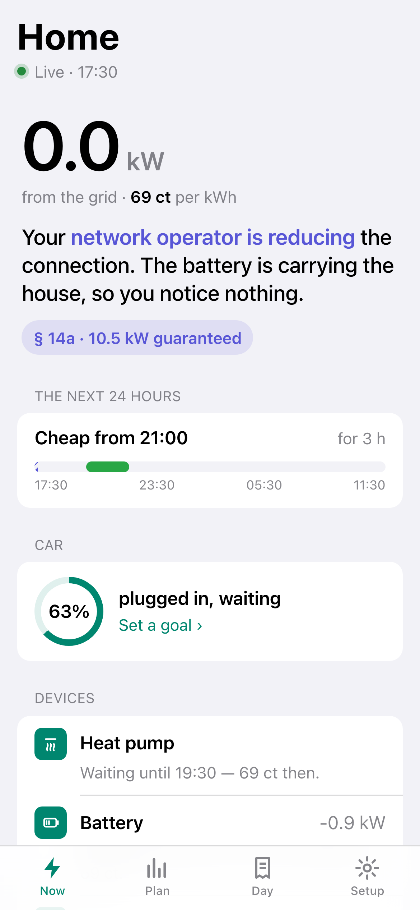
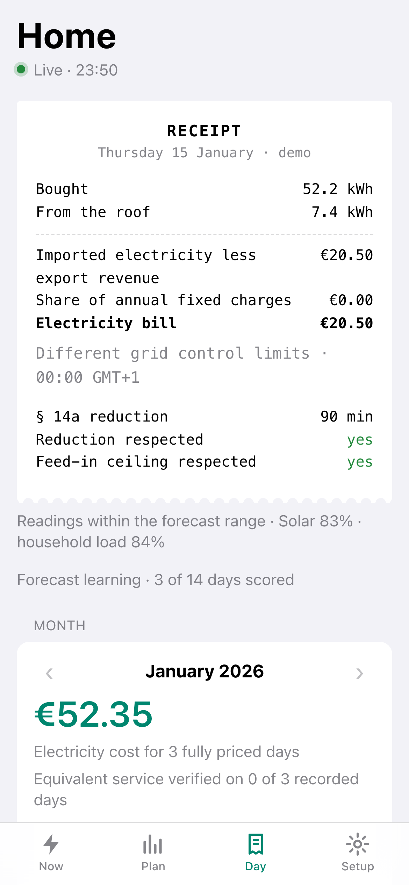
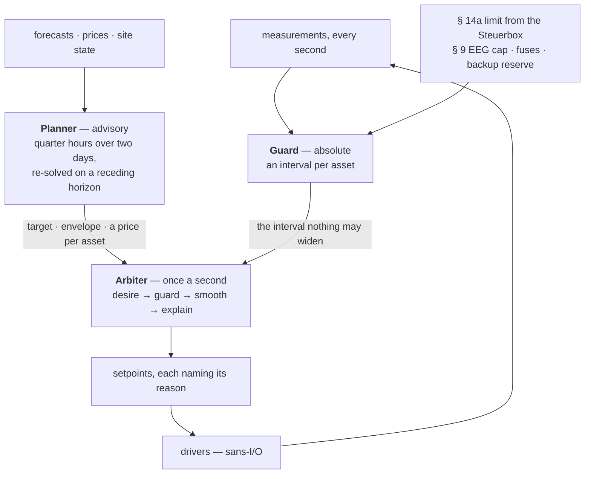

<h1 align="center">⚡ ems</h1>

<p align="center">
  <strong>Open-source energy management for the German grid — starting with hems, for households.</strong><br>
  The grid rules as cited, tested code. A guard nothing can override. Savings measured against the same house.
</p>

<p align="center">
  <a href="https://hupe1980.github.io/ems"></a>
  <a href="https://github.com/hupe1980/ems/actions/workflows/ci.yml"></a>
  <a href="#-licence"></a>
  
  
</p>

---

**ems** is the workspace: the grid rules, the guard, the planner, the
simulator and the protocols, as `ems-*` crates. **hems** (`hemsd`) is its
household product. It plans a household's battery, car, heat pump and hot water against
tomorrow's prices and weather, and obeys the rules that since 2024 make a German
house with a roof a small regulated power station: the network operator's
§ 14a EnWG reduction, the § 9 EEG feed-in cap, Modul 1–3 network fees, MiSpeL
storage accounting and § 42c energy sharing. New to those? Read
[the German grid in ten minutes](https://hupe1980.github.io/ems/docs/background/).

<p align="center">
  
  
  
</p>
<p align="center"><a href="site/static/media/walkthrough.mp4">▶ The walkthrough</a> · every image is the real page, rendering a simulated day through the real planner</p>

> [!NOTE]
> **Pre-alpha.** `hemsd run` drives real devices over SunSpec/Modbus TCP and
> EEBUS, accepts a network operator's Steuerbox over TLS, plans against fetched
> prices and weather, and serves the household page above over HTTPS. It is not
> yet certified. See [Status](#-status).

## 🚀 Quickstart

```console
$ git clone https://github.com/hupe1980/ems && cd ems
$ cargo run -p hemsd -- demo                     # open http://127.0.0.1:8080
```

`demo` simulates a January day through the real guard, arbiter and planner, then
serves the household page on it, with a slider through the day: the night
charge, the evening peak and a § 14a reduction at 17:00. No devices, no
configuration, no account. The same day as a report:

```console
$ cargo run -p hemsd -- simulate --day winter   # one January day, end to end
```

Only Rust 1.99 is needed for either. With [`just`](https://just.systems) and a
container runtime (Docker, Podman or Colima) for the PostgreSQL tests:

```console
$ just demo-all    # seven reference days and the comparisons worth seeing
$ just ci          # fmt, clippy, purity, tests, guards, licences, docs
$ just fleet-demo  # a box reporting its day into the fleet view
```

No hardware yet? A virtual house answers on the real protocols — a SunSpec
inverter, meter and battery over Modbus TCP and a network operator's Steuerbox
over EEBUS, with the day's prices and weather — and an ordinary box manages
it, in the same command:

```console
$ cargo run -p hemsd --features house -- house --run --at 16:58
```

To manage a real house, describe it in a file and check it before anything
connects:

```console
$ cargo run -p hemsd -- run --check --config services/hemsd/hemsd.example.toml
✅ 8 assets, 3 drivers, 6 resources described in S2
$ cargo run -p hemsd -- run --config /etc/hems/hemsd.toml
```

`--check` refuses, before a socket opens, what would otherwise fail silently at
runtime: a controllable device no driver can command, a Modul 3 calendar that
breaks the BDEW rules, a market identifier with a wrong check digit, a § 14a
regime declared for a device the household does not own. Every daemon ships an
annotated `<name>.example.toml` that a test parses, so the examples cannot drift.

Released binaries for `x86_64` and `aarch64` Linux are on the
[releases page](https://github.com/hupe1980/ems/releases), each with a CycloneDX
SBOM, `SHA256SUMS` and a build-provenance attestation
(`gh attestation verify hemsd-*.tar.gz --repo hupe1980/hems`).

## 💡 What makes it different

1. **The grid limit cannot be widened.** The § 14a limit lives in a guard plane
   that runs last and only intersects; a property test over a thousand random
   households, plans and overrides holds it.
   ([architecture](https://hupe1980.github.io/ems/docs/architecture/))
2. **It says why, in a sentence.** Every setpoint carries its reason — the
   grid, a price, a forecast or the household's override — and the household
   page renders it: *"Running at 3,3 kW — 36 ct is among the cheapest 15 % of
   the next two days."* No reason, no compile.
   ([the household page](https://hupe1980.github.io/ems/docs/household/))
3. **Savings against the same house.** The baseline owns the same battery, run
   the way it ships, under the same weather and rules; battery wear, comfort and
   undelivered charge are costs.
   ([planner](https://hupe1980.github.io/ems/docs/optimizer/))
4. **Rules with citations.** Every regulatory number carries its clause —
   `[BK6-22-300 A1 4.5.2]`, `[LPC-031]` — and the build fails on one it cannot
   resolve. ([grid rules](https://hupe1980.github.io/ems/docs/grid-rules/))
5. **The forecast is allowed to be wrong.** Each simulated day plays out weather
   the planner never saw and scores its own forecasts beside the money.
   ([forecasting](https://hupe1980.github.io/ems/docs/forecasting/))
6. **Local first.** Guard, arbiter and planner run on the box; without the
   internet it keeps planning on its cache and enforces the limit locally.
7. **The household's data stays the household's.** A local API for the box's
   history, a Data Act export, and an aggregator credential that can drive
   devices but not read when somebody was home.
   ([security](https://hupe1980.github.io/ems/docs/security/))
8. **Open to other energy managers.** An aggregator can drive the house over S2
   (EN 50491-12-2) with a credential the household can withdraw.
   ([flexibility](https://hupe1980.github.io/ems/docs/flexibility/))

## 🧭 How it is arranged



Each layer may only **narrow** what the layer above allowed, so "the grid limit
was respected" is a property of the structure rather than a code path somebody
remembered to write.

## 🏠 One day, end to end

```console
$ cargo run -p hemsd -- simulate --day winter

  2026-01-15 — with a § 14a reduction

  produced                                  7.4 kWh
  household consumption                    11.0 kWh
  charged into the car                     21.7 kWh
  heat pump                                22.1 kWh
  battery throughput                       14.6 kWh
  imported                                 52.2 kWh
  self-sufficiency                             12 %

  electricity bill                          20.50 €
  battery life spent                         0.58 €
  comfort given up                           0.13 €
  cost of the day                           21.61 €
  without optimisation                      22.70 €
  saved                                      1.10 €
  …of it on the bill                         0.83 €

  § 14a limit in force                       90 min
  …against a minimum of                     10.5 kW
  …covered by the store                     1.4 kWh
  § 14a limit respected                         yes
  § 9 EEG ceiling respected                     yes

  production forecast, CRPS  173 W (83 % of 30 lit)
  load forecast, CRPS           18 W (84 % covered)
```

An excerpt of about forty lines. **without optimisation** is the same house with
the same battery on its factory self-consumption rule, a wallbox that starts on
plug-in and ordinary thermostats; **saved** also charges battery wear and comfort,
so it is the honest figure and the bill difference the flattering one.

## 📦 Crates

The domain crates do no I/O, take time as a parameter and are usable on their own.

| Crate | What it is |
|---|---|
| [`ems-core`](crates/ems-core) | The vocabulary: one sign convention, the quarter-hour grid, assets and circuits, setpoints that must name a reason, the building and hot-water tank as stores, and the types edge and fleet exchange |
| [`ems-grid`](crates/ems-grid) | § 14a EnWG, the EEBUS LPC/LPP limitation machine, § 9 EEG, Modul 3, MiSpeL flow accounting, § 42c sharing, the two-year evidence record — all cited |
| [`ems-tariff`](crates/ems-tariff) | The price stack; parsers for ENTSO-E, SMARD, aWATTar, Tibber and Energy-Charts; the Modul 1/2/3 advisor |
| [`ems-forecast`](crates/ems-forecast) | Solar geometry and a physical PV model, a corrector that learns *this* roof, load and charging profiles, building identification, and the metrics that score them |
| [`ems-optimizer`](crates/ems-optimizer) | The receding-horizon MILP: cost, battery wear, comfort, hot water, shiftable appliances, per-slot grid limits |
| [`ems-realtime`](crates/ems-realtime) | The guard, the fair allocator for shared limits, the one-second arbiter |
| [`ems-device`](crates/ems-device) | What a wanted power becomes on hardware: amperes, phases, SG Ready contacts, and what a device will actually take |
| [`ems-drv`](crates/ems-drv) | The sans-I/O driver contract, SunSpec over Modbus TCP, and the EEBUS drivers behind features |
| [`ems-flex`](crates/ems-flex) | The household's flexibility in S2 (EN 50491-12-2) and the Resource Manager session |
| [`ems-sim`](crates/ems-sim) | Simulated battery, charge point, inverter, building, tank, appliances and Steuerbox, each with a way of saying no, and seeded weather |
| [`ems-events`](crates/ems-events) | The CloudEvents catalogue and the Standard Webhooks signature, enforced by a workspace guard |
| [`ems-service`](crates/ems-service) | The shell every daemon shares: configuration, secrets as references, health and metrics, capabilities, MCP mounting, signature verification, the one outbound HTTP client, HTTPS |

## 🛰️ Daemons

| Service | What it does |
|---|---|
| [`hemsd`](services/hemsd) | The box: guard, arbiter and planner against real devices, the household page over HTTPS, two years of § 14a evidence with an outbox for the fleet, and an S2 endpoint for an external energy manager |
| [`tariffd`](services/tariffd) | Day-ahead prices from five public sources, reconciled, cached two days each way |
| [`forecastd`](services/forecastd) | Irradiance from ICON-D2 via Open-Meteo — the sky, not a finished forecast; each box corrects for its own roof |
| [`histd`](services/histd) | The fleet's § 14a evidence and settlement registers in PostgreSQL, versioned, with the operator's Nachweis and the household's Data Act export |
| [`fleetd`](services/fleetd) | Single-use enrolment, the fleet roster, and signed configuration and release manifests (the box-side client is not built yet) |
| [`obsd`](services/obsd) | The fleet view: signed day reports, § 14a breaches counted as named findings rather than averaged into a rate |
| [`agentd`](services/agentd) | An advisory plane on [agentplane](https://github.com/hupe1980/agentplane): findings across the fleet, replayable from a journal. It proposes and cannot act |

Every fleet service can mount a **read-only** MCP surface at `/mcp` on the port
it already binds, and authorises each call as its own caller with the same
credentials its REST routes use.

## 📊 Status

| Works today | |
|---|---|
| Grid rules | § 14a, § 9 EEG, § 51, Modul 3, MiSpeL, § 42c and the two-year evidence record, all cited |
| Control | The guard, the allocator, the one-second arbiter and the receding-horizon MILP, planning against three futures where a service is at risk |
| Devices | SunSpec inverters, meters and batteries and vendor Modbus maps; EEBUS LPC/LPP with a Steuerbox over a real SHIP session, the heat pump, the hot-water tank and the car |
| External energy managers | S2 Resource Manager at `/s2/{asset}`, clamped by the guard, with named, revocable credentials |
| The household | A page served by the box over HTTPS — now, the plan, a receipt and its month, pairing — in German and English; goals for the car and the hot water answered *feasible / tight / impossible* and priced before they are set; the plan in sentences, with the price at which it would rather export than store; notifications for the four occasions worth one; the same events, signed, to Home Assistant or any webhook; a wall display; a printed handover sheet with QR codes; local history at `/v1/series`; overrides; a factory reset that refuses while evidence is unforwarded |
| The fleet | Prices, weather, evidence, enrolment, signed day reports, the fleet view, advisory findings |
| Evaluation | Seven reference days and a cold first day, multi-day back-test and risk sweeps, forecasts scored in CRPS |

**Limits today:** no certification yet — EEBUS and S2 are tested against the
libraries hems is built on, not against another implementation; the box does not
yet enrol with the fleet or pull configuration and updates; no remote access to
the household page; no OpenADR, § 41e, V2H/V2G or Matter.

## ✅ Quality

1 367 tests. `just ci` runs formatting, Clippy with warnings as errors, a purity
check that keeps clocks and sockets out of the domain crates, the whole suite,
the workspace guards, `cargo-deny` and the docs. The guards make the claims above
checkable:

- `check-citations` — 469 citations across five document families; all 469 of them against an index of primary sources resolve, or the build fails.
- `check-wire` — the 140 quantities and instants, each of which becomes money or evidence, say how they travel.
- `check-deps-used` — 266 declared dependencies, every one reached from source.
- `check-actions` — every GitHub Action pinned by commit.

Regulatory documents are cited, never redistributed: `[BK6-22-300 A1 4.5.2]` is
the lookup key a network operator or a laboratory would ask for. The threat
model is [THREAT_MODEL.md](THREAT_MODEL.md).

## 🤝 Related crates

hems consumes rather than reimplements:
[`metering`](https://github.com/hupe1980/metering) (the Berlin calendar, OBIS,
the § 14a minimum power, Modul 3 calendars, the § 42b/c allocation),
[`eebus`](https://github.com/hupe1980/eebus) (SHIP and SPINE, the LPC/LPP
machine, a conformance suite), [`s2-kit`](https://github.com/hupe1980/s2-kit)
(the S2 data model, a semantic validator and session engines),
[`sunspec`](https://crates.io/crates/sunspec) (the SunSpec models),
[`chronix`](https://github.com/hupe1980/chronix) (the box's own measurement
series) and [`agentplane`](https://github.com/hupe1980/agentplane) (the
advisory runtime). The market side is [`mako`](https://github.com/hupe1980/mako).

[`iso15118`](https://github.com/hupe1980/iso15118) is deliberately not a
dependency: ISO 15118 is spoken on the charging cable between a wallbox and a
car, and hems sits upstream of the wallbox.

## 📄 Licence

MIT OR Apache-2.0, at your option.

hems is not affiliated with the Bundesnetzagentur, the BDEW, the EEBus Initiative
or the VDE. Regulatory documents are cited, never redistributed.
