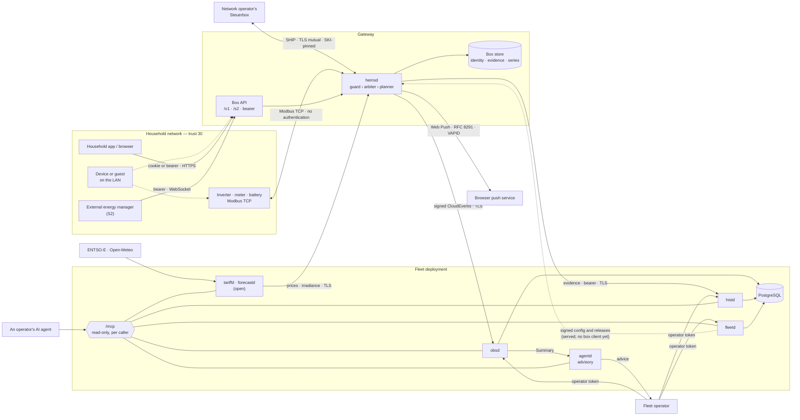

# Threat model

This model covers local edge applications, household equipment, fleet services and their release chain. The [security guide](site/content/docs/security.md) describes deployment controls. The [agent guide](site/content/docs/agents.md) describes fleet read access.

A **control** has implementation or test evidence. **Partial** identifies a remaining gap, **open** identifies an unmitigated risk, and **accepted** records a known exposure. Severity describes the risk before controls.

The household gateway can send commands to equipment. The building and industrial demo servers serve synthetic data on loopback. Building community views restrict what each role sees. Industrial reconciliation reads local evidence and independently supplied closes. The optional OPC UA client pins the server leaf, checks the contract’s namespace, type and units, and retains source time and quality. The site operator supplies the approved mapping and controls the capture files. Both demo servers expose read-only routes. The optional CEMS OpenADR command starts its own loopback aggregator and site client for a single simulation using process-local credentials.

The operator desk binds each check-in to its enrolled site and filters reads by operator scope. Server receipt time measures contact. Feeder and closure times are gateway claims. A compromised gateway can misreport its own observations. The desk has no device-control actions.

The browser ingress authenticates users with OIDC and maps the verified subject of one configured issuer to a scoped API bearer. Keep the identity-header listener private to that proxy. The customer gateway forwards the scoped bearer only to fixed collector routes, refuses redirects and rechecks downloads. The household receipt collector binds signed outlet evidence to its gateway key. A dedicated customer token reads one site’s latest receipt and up to 30 daily reports. Replayed partial evidence preserves the final register. A compromised signer can misstate its own measurements.

## Trust boundaries

| Boundary | What crosses it | The control at the crossing |
|---|---|---|
| Steuerbox → box | § 14a limits, failsafe values, heartbeats | SHIP over TLS 1.2 with mutual authentication; a peer whose SKI is not in the trust store is held short of the data phase |
| Devices ↔ box | Meter, PV and battery readings; curtailment and battery setpoints | **None at the protocol**: Modbus TCP has no authentication. The guard handles a *silent* device conservatively; it does not detect a *lying* one |
| LAN → box API | Household reads, goals, overrides, pairing, energy-manager sessions | One credential layer over every `/v1` and `/s2` route — bearer, or the page's session cookie; loopback by default, HTTPS with the box's own kept certificate once widened. The household's own routes refuse a manager's credential |
| Box → push service | A notification's sentence, to a subscribed browser | Only `https` to a listed browser push service, no redirects; payload encryption to the browser (RFC 8291) and VAPID authentication to the push service (RFC 8292). The service still sees when the box speaks |
| Box → hosts the household names | A SunSpec identity read during commissioning | Literal private addresses only, port 502 or 1502, sixteen at most, read-only, bounded in time; a configured device is never dialled twice |
| Box → fleet | Day reports, § 14a evidence, price and forecast reads | Standard Webhooks signature per box key, bound to its site; bearer tokens; TLS with plain `http` refused except to loopback and optionally pinned roots |
| Operator / agent → fleet | The Nachweis, the fleet view, the roster, MCP reads | Capabilities with a site and tenant scope on every credential; an aggregate needs `hems.fleet.read` by name; each MCP call authorised as its own caller |
| Fleet → box (designed) | Configuration and release manifests | Ed25519 signatures against a key the box was built with; `fleetd` never holds the key. The box does not yet pull either |
| Release → deployment | Binaries, crates | cargo-deny, `cargo auditable`, CycloneDX SBOM, checksums, build-provenance attestation |

## Assets

| Asset | Why it matters |
|---|---|
| The box's SHIP private key and Steuerbox trust store | Whoever holds the key *is* this household to the network operator's control box |
| The box API token and energy-manager tokens | Read the household's life; drive its battery and car. The household's token is also the session cookie and the sign-in code printed on the handover sheet |
| Push subscriptions and the box's Web Push signing key | Reach the household's phones in the box's name |
| Webhook subscriptions, their signing secrets and what each is owed | Tell Home Assistant or an installer, in the box's name, that the operator is reducing the house; a subscriber URL can itself be the receiver's only credential |
| Fleet credentials — box tokens, enrolment secrets, operator tokens, per-site webhook keys, the database URL | Each one is an identity; a webhook key decides whose day a report is |
| The release- and configuration-signing key | The one thing a box trusts unconditionally |
| § 14a evidence and settlement registers | The record a network operator may ask about for two years; MiSpeL money is computed from it |
| Measured series, the ninety closed days and goals kept on the box, and the Data Act export | When the household showered, cooked and went away — and when the car leaves |
| Setpoints and overrides | Move real power: a fuse, a car's range, a cold house |
| § 14a limits, failsafe values, the § 9 EEG ceiling | What the guard holds the house to |
| The fleet view and roster | Which households breached a reduction; which are unpatched |
| Prices and forecasts | Every box's plan, and so the household's bill |
| A box's configuration | Which assets exist, the comfort band, where the box reports |
| agentd's journal | The replayable record of every finding |

## Threats

### The household network

| Threat | Sev | Mitigation | Evidence | Status |
|---|---|---|---|---|
| `lan-meter-spoofing` — a device on the LAN answers Modbus reads as the grid meter or inverter, and the guard bounds the house against numbers that are not true | high | Silence is handled conservatively; a plausible lie is not detected | — | **Open** (SR-001) |
| `lan-modbus-direct-write` — a device on the LAN writes the inverter's or battery's registers itself, bypassing the guard | high | Outside hems's code; installation guidance on segmenting the devices is not yet written | — | **Open** (SR-002) |
| `box-token-sniffing` — the box or a manager token is read off the LAN where the API is widened beyond loopback without TLS | high | HTTPS on by default off loopback, with a self-signed certificate the box keeps (its fingerprint printed and on the page); plain HTTP on a LAN address is refused at start-up unless `[api] insecure_lan` is written down | `runtime/tls.rs` `a_lan_address_in_clear_is_refused_unless_written_down`, `a_restart_serves_the_same_certificate` | Control |
| `box-api-unauthenticated` — a caller without the household's token reads, overrides or connects a manager | high | One bearer layer over the whole assembly; token from OS entropy; every failure one `401` | `runtime/access.rs` `every_way_of_not_presenting_a_token_is_refused`, `a_token_opens_its_own_household_and_nothing_else` | Control |
| `manager-reads-export` — an energy manager's credential reads the household's measured life | high | Household capabilities less `hems.export.read` | `tests/managed_by_a_cem.rs` `a_manager_may_drive_the_house_and_not_read_its_life` | Control |
| `manager-revocation-lag` — a withdrawn manager goes on driving the battery | high | Withdrawal effective on the next request; an append-only set rebuilt from the store | `managed_by_a_cem.rs` `a_manager_is_named_and_can_be_withdrawn`, `a_manager_that_stops_driving_stops_being_obeyed` | Control |
| `limit-widened-by-a-lower-plane` — a manager, an override or a plan moves a device past the § 14a or § 9 EEG bound | high | Guard › arbiter › planner; the guard clamps and the manager is told | `managed_by_a_cem.rs` `a_manager_is_told_when_the_grid_overrides_its_instruction` | Control |
| `box-actions-unattributed` — a manager instruction or an override cannot be attributed to the credential that sent it | medium | Each S2 session runs in a span carrying its credential's subject (`cem:<name>`, `site:<id>`), so every instruction line names its sender; a manager's name is restricted so it cannot forge a line. Overrides, goals, pairing decisions, discovery, push subscriptions and a replaced token each log the subject; no test asserts those lines | `tests/managed_by_a_cem.rs` `a_managers_instruction_is_logged_under_its_own_name`; `runtime/access.rs` `a_name_that_could_forge_an_audit_line_is_refused`; `runtime/api.rs` `subject` | Partial (tests) |

### The household page

The page is a handful of static files compiled into `hemsd` and served outside
the access layer; everything it shows comes from `/v1` behind it. A browser
signs in once and holds the token as a cookie. Every route below answers the
household's own credential only.

| Threat | Sev | Mitigation | Evidence | Status |
|---|---|---|---|---|
| `session-cookie-csrf` — a page on another site makes the household's browser send its cookie with a write | high | The cookie is `SameSite=Strict`; a write authenticated only by the cookie must carry `application/json`, which a cross-site form cannot send | `tests/household_surface.rs` `a_write_on_the_cookie_needs_a_json_body` | Control (SR-039) |
| `session-cookie-theft` — the session cookie is read by a script or sent in clear | medium | `HttpOnly`, `Secure` under HTTPS; the page never stores the token | `household_surface.rs` `signing_in_hands_back_a_cookie_no_script_can_read`, `over_https_the_cookie_is_secure_and_the_pinned_certificate_is_the_boxs`; `ui.rs` `the_page_never_keeps_the_credential_where_a_script_could_read_it` | Control (SR-038) |
| `manager-signs-into-the-page` — a manager's credential signs into the page, or reads `/v1/home`, and so reads the household's life | high | Sign-in accepts only the household's own credential; `/v1/home` is on the household-only list | `household_surface.rs` `only_the_households_own_token_signs_in`; `tests/managed_by_a_cem.rs` `a_manager_cannot_decide_who_else_may_act_on_the_box` | Control (SR-038) |
| `page-script-injection` — script reaches the page and acts with the household's session | medium | `default-src 'self'`, `script-src 'self'`, `frame-ancestors 'none'` (style attributes only allowed inline); every value escaped before rendering; nothing loaded from elsewhere; the service worker only shows a notification and opens the page | `ui.rs` `the_page_loads_nothing_from_anywhere_else`, `the_service_worker_only_shows_and_opens` | Control (SR-040) |
| `manager-repairs-the-steuerbox` — a manager's credential approves a control box of its own, or forgets the household's, or mints other managers | high | Pairing and manager administration are reachable only with the household's own credential, and each decision logs its subject | `managed_by_a_cem.rs` `a_manager_cannot_decide_who_else_may_act_on_the_box` | Control |
| `goal-write-by-manager`, `goal-wrong-kind` — a manager sets *100 % by now*, or a goal for one kind of device is applied to another | medium | `/v1/goals/{asset}` is household-only; the body is read by the asset's own kind, unknown fields and out-of-range values refused, a tank target clamped to what the tank can hold | `managed_by_a_cem.rs` (as above); `runtime/api.rs` `a_goal_is_refused_when_it_is_out_of_range_or_for_the_wrong_device`; `home.rs` `a_goal_is_typed_by_the_asset_it_is_for` | Control |
| `goals-outlive-household` — kept goals pass to the next household with the box | low | Goals live only in the box's store and go with the factory reset | `home.rs` `goals_survive_a_restart_and_not_a_factory_reset` | Control |
| `manager-reads-the-month` — a manager's credential reads the ninety closed days or their CSV | medium | `/v1/days` and `/v1/days.csv` are household-only | `managed_by_a_cem.rs` (as above) | Control |
| `closed-days-outlive-the-household`, `closed-days-grow-or-churn-the-store` — the kept days survive a resale, or grow without bound | medium | Ninety days at most, pruned in the transaction that closes a day; emptied by the factory reset | `store.rs` `the_box_keeps_ninety_closed_days_and_no_more`, `a_box_back_after_a_year_keeps_only_the_new_window` | Control |
| `csv-carries-a-formula-or-lingers` — the exported CSV carries a cell a spreadsheet executes, or is cached on a shared device | low | Dates, numbers and booleans the box formats itself, no free text; an uncached, unsniffed attachment | `month.rs` `the_csv_is_one_row_per_day_with_a_decimal_point` | Control |
| `forward-saving-misleads` — the page shows a forward *with / without hems* pair the box cannot stand behind | medium | `/v1/home` carries the plan's expected bill and its window only, absent where the plan is unpriced; the plan's baseline is held to the day report | `home.rs` `the_bill_ahead_is_shown_only_where_the_plan_prices_it`; `tests/plan_prices.rs` `the_january_plan_prices_the_january_day` | Control |
| `unattended-display-holds-the-session` — a tablet on the wall holds the household's full session; whoever takes it can leave the wall view and set goals or approve a control box | medium | None beyond the cookie's own flags: a read-only display credential does not exist yet | — | **Accepted** until 2027-05-15 |
| `glance-shows-commissioning-secrets` — a shared display reveals a pairing credential | low | The wall view requires sign-in and limits its content to household status | `xtask/media.mjs` checks the rendered wall display | Control |
| `demo-exposed` — `hemsd demo`, which asks for no credential, is reachable from the network | low | The demo refuses any address that is not loopback, before it simulates anything | `household_surface.rs` `the_demo_refuses_an_address_off_this_machine`, `the_demo_command_refuses_before_it_simulates_a_day` | Control (SR-041) |
| `contract-misstates-who-may-call` — the published API contract drifts from the routes: it lists a household route as open to a manager, omits a route, or carries an example credential that is copied into a deployment | low | The contract is generated from the routers' own table and types; `cargo xtask check-api` fails on any difference. The route test reads the routers' source, so a router mounted from a file it does not read would be missed | `hemsd/src/openapi.rs` `the_table_lists_exactly_what_the_routers_mount`, `the_household_only_routes_are_the_ones_the_access_layer_guards`, `the_contract_carries_no_credential` | Control |

### Commissioning and the handover sheet

The Setup view shows the box's identity as text and QR codes, prints one sheet
for the installer and the household, and can look for devices on the network.
For whoever ordered the installation it signs a commissioning record: what is
paired and set up, bound to the order's reference.

| Threat | Sev | Mitigation | Evidence | Status |
|---|---|---|---|---|
| `signin-code-undoes-httponly` — the sign-in code is fetched on the session cookie, so a script in the page or a manager reads the long-lived token the cookie exists to withhold | high | `/v1/qr/signin` answers only a request carrying the token in `Authorization` — never the cookie, never a manager — with `no-store`; the token sits in the link's fragment | `tests/household_surface.rs` `the_sign_in_code_answers_only_somebody_who_already_holds_the_token` | Control |
| `handover-sheet-is-a-credential` — whoever photographs or keeps the printed sheet can sign in | medium | The household can replace its token from the page; every session and every printed sheet then stops working, managers keep theirs. The sheet remains a key until that is done | `household_surface.rs` `replacing_the_token_ends_every_session_and_every_sheet`; `runtime/access.rs` `a_replaced_token_is_kept_and_the_old_one_is_dead` | Control |
| `signin-code-points-elsewhere` — a forged `Host` or a crafted origin makes the printed code send the token to another site | medium | The origin in the code is a scheme and `host[:port]` and nothing else | `runtime/handover.rs` `an_origin_is_a_scheme_and_a_host_and_nothing_a_scanner_would_follow_elsewhere` | Control |
| `manager-reads-commissioning` — a manager reads the sheet, the trust check or the codes, or asks for a discovery | medium | `/v1/qr`, `/v1/handover`, `/v1/discover`, `/v1/trust` and `/v1/token` are household-only | `household_surface.rs` `a_manager_reaches_nothing_of_commissioning` | Control |
| `discovery-is-a-port-scanner` — discovery makes the box connect where the caller chooses: mapping the network, reaching beyond it, or evicting the box's own driver from a one-client inverter | medium | Literal private addresses only, port 502 or 1502, sixteen at most, 1.5 s, read-only; a configured device is never probed; each ask logged with its subject | `household_surface.rs` `discovery_looks_only_where_a_household_network_is`; `runtime/handover.rs` `only_literal_private_addresses_are_ever_probed`, `a_host_the_box_already_manages_is_not_dialled_a_second_time` | Control |
| `discovered-text-forges-a-line` — a device answers discovery with a name carrying control characters or markup | medium | SunSpec strings and SHIP TXT values reduced to bounded printable ASCII before they are returned or logged; the SHIP path is read, not tested | `ems-drv/src/modbus/probe.rs` `what_the_device_calls_itself_cannot_carry_a_control_character` | Control |
| `record-key-signs-two-protocols` — the key behind the box's SKI signs TLS handshakes and commissioning records; a signature made for one is presented as the other, or a caller steers what a record's signature covers | medium | The key signs nothing else. Every record's signing input is base64url text beginning with its own protected header (`alg: ES256`, `typ: hems-commissioning+jws`), which no TLS signature input is; the only caller-chosen text is the reference | `runtime/handover.rs` `every_signing_input_begins_with_the_records_own_header`; `tests/commissioning_record.rs` `the_record_verifies_with_nothing_but_what_it_carries` (a verifier sharing no code with the signer) | Control |
| `record-of-another-box-or-day` — a valid record from another box, or an old one of this box, is presented as the result of a new order | low | The record carries the order's reference byte for byte, the instant of signing and the signer's SKI, and states only what the sheet and the trust check state. Comparing the reference and the SKI with the order is the verifier's step; the box cannot do it | `commissioning_record.rs` `the_record_verifies_with_nothing_but_what_it_carries`, `a_changed_record_no_longer_verifies`, `without_a_reference_the_record_carries_none` | Control; the comparison is the verifier's |
| `manager-reads-the-record` — a manager fetches the signed record and with it the control box's SKI and the household's devices, in a form made to be passed on | low | `/v1/commissioning` and its code are household-only and `no-store` | `commissioning_record.rs` `a_manager_is_handed_no_record` | Control |
| `reference-carries-more-than-a-name` — the reference carries control characters, markup or octets chosen to shape the signed text, the code or a log line | low | 1 to 64 printable ASCII characters without a space, refused before anything is signed | `commissioning_record.rs` `a_reference_that_is_not_plain_text_is_refused`; `runtime/handover.rs` `a_reference_is_printable_ascii_without_a_space` | Control |
| `record-too-dense-to-scan` — a house with many devices yields a code no phone reads, and the installer photographs the screen or the wrong code instead | low | The code leaves out the certificate and stops at 1,732 octets (QR version 30, level L): seven devices fit, the eighth answers `413` and the page offers the download. The completion code has a view of its own, apart from the household's sign-in code. The `413` is tested at the drawing function, not over HTTP | `runtime/handover.rs` `a_code_carries_seven_devices_and_refuses_the_eighth`, `the_code_is_measured_against_what_a_phone_reads_off_a_screen`; `commissioning_record.rs` `the_code_is_the_same_record_without_its_certificate_and_small_enough_to_scan` | Control |

### Notifications

The gateway sends encrypted notifications to browsers enrolled by the household. Push services see request timing.

| Threat | Sev | Mitigation | Evidence | Status |
|---|---|---|---|---|
| `push-endpoint-ssrf` — a subscription's endpoint points the box at the household's network or any host, and the box POSTs there on every event | high | An endpoint is accepted and used only over `https`, default port, no userinfo, under one of five browser push-service host suffixes; no redirect is followed. A self-hosted push service is refused by design | `runtime/push.rs` `only_a_push_service_over_https_is_an_endpoint` | Control |
| `push-payload-disclosure` — the push service or the path reads or forges what the box tells a browser | medium | RFC 8291 `aes128gcm` with a fresh key and salt per message; RFC 8292 signature by the key the browser subscribed with; held to the RFC's worked example | `runtime/webpush.rs` `the_rfc_s_own_example_encrypts_to_the_rfc_s_own_bytes`; `runtime/push.rs` `a_reduction_is_exactly_two_encrypted_notifications_only_the_browser_can_read` | Control |
| `push-payload-overshare` — a notification carries measurements, prices or device names onto a lock screen or into a log | medium | A fixed sentence and the view to open; the log names the push service's host, never the endpoint | `runtime/push.rs` `every_event_has_a_sentence_in_both_languages_and_no_number_in_it` | Control |
| `push-metadata-timing` — the push service learns when this box speaks, and so roughly when its operator reduces the connection | medium | Inherent to Web Push. The payload says nothing and notifications are opt-in per event; the timing itself is not hidden | — | **Open** (residual: the timing cannot be hidden; telling the household so before it subscribes is not yet written) |
| `manager-subscribes` — a manager subscribes a browser of its own, or lists and removes the household's | medium | `/v1/push` is household-only; no answer contains a subscription's keys or the signing key; subscribing and unsubscribing log the subject | `tests/push_routes.rs` `an_energy_manager_s_credential_does_not_reach_notifications` | Control |
| `push-survives-resale` — a resold box goes on telling the previous household's phones | low | The factory reset removes every subscription and the signing key | `store.rs` `push_subscriptions_are_capped_kept_and_gone_after_a_reset` | Control |
| `push-fanout-exhaustion` — subscriptions, per-tick notifications or retries turn an event into a storm of outbound requests | medium | Eight subscriptions at most; one notification per episode; a ten-second budget; nothing queued or retried. Checked over a reference day; `tests/a_day_of_notifications.rs` | Control |

### Events out

The household chooses the destination and events. Each delivery carries a signed CloudEvent. Its receiver checks the signature and timestamp and deduplicates by event ID.

| Threat | Control | Evidence |
|---|---|---|
| Requests to the gateway itself or a disallowed network destination | Check all resolved addresses at registration and delivery, reject local interfaces and broadcasts, pin the connection and refuse redirects. Public destinations require stored household consent and HTTPS. | [Destination validation](services/hemsd/src/runtime/webhooks.rs) |
| Leaked credentials or unauthorized subscriptions | Household-only routes manage subscriptions. The signing key is returned at creation. The audit records the destination host without its secret path. | [Subscription API](services/hemsd/src/runtime/api.rs), [manager access tests](services/hemsd/tests/managed_by_a_cem.rs) |
| A slow receiver delays control or grows an unbounded queue | A separate delivery task bounds requests, queues, logs and retention. Pending deliveries expire after 24 hours. | [Delivery, timeout and expiry tests](services/hemsd/tests/events_out.rs) |
| A revoked subscription reappears or survives resale | A completed attempt updates an existing subscription only. Factory reset clears stored subscriptions and deliveries. | [Revocation and restart tests](services/hemsd/tests/events_out.rs) |

### Port qualification and image publication

The probe uses separate service credentials and a single-use callback address on a private network. It checks refusal of anonymous clients, independently verifies the signed body and revokes its temporary subscription. Release evidence contains port outcomes, architecture and image digests. Tagged publication compares each archived manifest with that evidence before copying it to the registry. [Probe](tools/conformance/probe.py) · [Image verification](tools/conformance/images.py) · [Promotion](.github/workflows/release.yml)

### Replay integrity

A later reading can make a decision look justified before the operator had evidence. The building demo provisions two station identities with separate ephemeral credentials. The central system binds each connection to its own meter inbox, and the handover checks arrival time on each station event. The protocol listener closes before the read-only handover opens. The industrial replay computes the decision from the observations available by its cursor and reveals the independent meter close only on request. Both HTML and JSON exercise these boundaries. [Building replay checks](xtask/building_replay.py) · [Industrial replay checks](xtask/industrial_replay.mjs)

The public peak challenge accepts two dispatch choices in a browser-local Wasm module with zero host imports. Its parity check compares each projection and the independent meter close with the native industrial model. The page falls back to a worked example when the module or its readings are unavailable. [Parity check](tools/ems-wasm/parity.mjs) · [Browser check](xtask/peak_challenge.py)

### Asking the plan

A goal preview compares two schedules using cloned inputs. Only the household may request it. One solve pair runs at a time, with a solver budget and a cooldown. The background task owns the quote slot through completion, including when the caller disconnects. Setting the goal requires a separate confirmed write. [Quote handler](services/hemsd/src/runtime/api.rs) · [Access and concurrency tests](services/hemsd/tests/household_surface.rs) · [Plan comparison tests](services/hemsd/tests/planned_house.rs)

### The virtual house

`hemsd house` — simulated SunSpec devices and a simulated Steuerbox for
development and CI — exists only in a build with the `house` feature.

| Threat | Sev | Mitigation | Evidence | Status |
|---|---|---|---|---|
| `house-served-to-the-lan` — a virtual house on a network address answers any reader and is mistaken for the household's inverter | low | Refuses a non-loopback address unless `--exposed` is given | `house/mod.rs` `a_house_is_not_served_to_the_network_by_accident` | Control |
| `simulator-steuerbox-key-reused` — a box left trusting the simulator Steuerbox can be reduced by whoever holds its key file | low | The key is written `0600`; the configuration it writes keeps SHIP on loopback and off mDNS and says it is a simulator's | `house/steuerbox.rs` `a_kept_identity_keeps_its_ski_and_is_the_owners_alone` | Control |
| `simulator-server-in-the-box` — the simulator's Modbus server ships inside every box | low | An optional dependency behind the `house` feature; CI fails if the default build's tree contains it | `.github/workflows/ci.yml` job `house` | Control |
| `curtailment-on-the-wrong-register` — a production ceiling written at the wrong offset of SunSpec model 123 disconnects the inverter instead of limiting it | high | The address is the model body plus the published `WMaxLimPct` offset, held against an independently written server | `tests/virtual_house.rs` `every_device_is_discovered_read_and_obeyed_over_modbus` | Control |
| A stale or invalid model 704 command changes the simulated battery balance | medium | Management requires an opted-in loopback battery, fresh local input and a matching device profile. The gateway checks the Modbus unit, transaction, write echo and register readback. The device releases after 30 simulated seconds. | `just house-storage-trial` | Control |

The household OCPP departure trial binds an ephemeral loopback port, permits one authenticated station and validates its connector, transaction, sample time and register boundaries. A returned station needs a fresh register before the next profile. The receipt withholds its outlet total when the close is missing. Connection energy requires four consecutive, monotonic, directional readings from the separate loopback meter. [Departure trial](services/hemsd/src/house/departure.rs)

### The Steuerbox and the box's identity

| Threat | Sev | Mitigation | Evidence | Status |
|---|---|---|---|---|
| `steuerbox-spoofing` — an unpaired device presents itself as the network operator's control box | medium | SHIP mutual TLS; SKI trust store; a mistyped SKI refused | `tests/steuerbox_session.rs` `an_untrusted_steuerbox_completes_tls_and_is_held_short_of_the_data_phase`, `a_mistyped_ski_is_refused_rather_than_stored` | Control |
| `ship-key-theft` — the SHIP private key is read from the gateway's disk | high | None: no secure element or TPM path | [security page](site/content/docs/security.md#gateway-trust-and-pairing) states it | **Open** (SR-009) |
| `resale-identity-carryover` — a resold box carries the previous household's identity, tokens or readings | high | Factory reset clears every table in one transaction | `store.rs` `a_factory_reset_leaves_a_box_that_looks_like_it_left_the_factory` | Control |
| `reset-erases-evidence` — a reset erases evidence the fleet has not received | high | The reset refuses while the fleet is owed anything; the way through is named for what it costs | `store.rs` `a_reset_is_refused_while_the_fleet_is_still_owed_evidence` | Control |
| `box-evidence-edited-at-rest` — someone with the disk edits § 14a evidence before it is forwarded | medium | None: the box store is not tamper-evident | — | **Open** (SR-011) |

### Box to fleet

| Threat | Sev | Mitigation | Evidence | Status |
|---|---|---|---|---|
| `report-forgery-or-replay` — a day report is forged, edited after signing or replayed | high | Standard Webhooks over id, timestamp and bytes; five-minute window; unknown fields refused; deduplicated on the signed id | `obsd/tests/fleet_view.rs` `an_unsigned_report_is_refused`, `a_report_edited_after_signing_is_refused`, `a_captured_report_stops_working`; `ems-events/src/webhook.rs` | Control |
| `report-as-another-household` — a box reports a day as another household, putting a compliant site on the breach list | high | One key per box; a report whose site is not the key's is refused; two sites on one key stop `obsd` | `fleet_view.rs` `a_box_cannot_report_a_day_as_another_household` | Control |
| `outbound-plaintext-or-wrong-anchor` — a daemon reaches the fleet over plain `http` or trusts a CA it was not meant to | high | Plain `http` refused except to loopback; `pinned` roots replace the platform's; an empty bundle stops the daemon | `ems-service/src/http.rs` `a_pinned_bundle_that_is_not_there_stops_the_daemon` | Control |
| `config-or-release-substitution` — a compromised `fleetd` hands a box a configuration or release nobody signed | medium | Signature primitives and the serving side exist; **no box-side client** pulls or verifies either yet | `ems-service/src/update.rs` `a_configuration_edited_after_signing_is_refused`; `fleetd/tests/adoption.rs` | Partial (SR-014) |
| `price-feed-manipulation` — a compromised price feed makes every box charge at the peak | medium | The guard reads no price; an absent slot is no price rather than zero; TLS to the publisher. No plausibility bound on a served curve | `ems-service/src/http.rs` | Partial (SR-015) |

### Fleet access and personal data

| Threat | Sev | Mitigation | Evidence | Status |
|---|---|---|---|---|
| `cross-site-read` — one box's credential reads another household | high | Site scope on every credential | `ems-service/src/auth.rs` `a_box_may_read_and_write_its_own_site_and_no_other`; `histd/tests/evidence_survives.rs` `one_households_export_never_contains_anothers` | Control |
| A changed register is submitted under an accepted revision | high | The historian rejects the whole batch on conflict. A later revision has its own acceptance time, preserving earlier receipts. | `histd/tests/who_may_ask.rs` · `register_revisions_retry_conflict_or_correct_over_http` and `the_first_receipt_supplies_a_replayable_cutoff_even_for_a_future_request` | Control |
| Concurrent household history reads delay control | high | One blocking worker per gateway handles history reads and JSON encoding. A busy gateway returns 503, including while a disconnected client's query finishes. | `hemsd/src/runtime/api.rs` · `cancelling_a_history_request_keeps_the_worker_bounded_until_it_finishes` | Control |
| `cross-tenant-read` — one tenant's operator reads another tenant's households | high | Tenant on every credential; an undefined tenant stops the daemon; aggregates within scope; `"*"` only when written | `auth.rs` `one_tenants_operator_cannot_read_another_tenants_household`; `fleet_view.rs` `one_tenants_read_does_not_pull_anothers_rows` | Control |
| `operator-reads-export` — an operator reads the Data Act export or writes the record it is judged by | high | Operators read the Nachweis only | `histd/tests/who_may_ask.rs` `an_operator_reads_the_nachweis_and_never_the_data_act_export`, `an_operator_may_not_write_the_record_it_is_judged_by` | Control |
| `household-reads-fleet` — a household's token reads the breach list, roster or advisory queue | high | `hems.fleet.read` asked for by name | `auth.rs` `a_household_never_reads_an_answer_about_every_household`; `fleetd/tests/adoption.rs` `the_roster_is_not_public`; `agentd/src/api.rs` `a_boxs_own_token_does_not_read_the_advisory_queue` | Control |
| `token-guessing` — a credential recovered by timing, or a service with no credentials accepting everyone | high | Constant-time comparison; an empty set accepts nothing | `auth.rs` `the_comparison_does_not_stop_at_the_first_difference`, `a_service_with_no_credentials_accepts_none` | Control |
| `enrolment-abuse` — an enrolment secret reused or guessed to adopt a site | high | Single-use as a database constraint; failures indistinguishable; no rate limit | `fleetd/src/store.rs` `the_single_use_secret_is_a_constraint_and_not_a_check`; `registry.rs` `every_credential_failure_looks_the_same_to_a_caller` | Partial (SR-019) |
| `secret-in-config-logs-errors` — a credential in a file, a log line or an error body | high | `env:`/`file:` references resolved once, never falling back to the literal, redacted; the database URL never in an error | `ems-service/src/config.rs` `a_secret_is_not_printed_and_a_reference_is` | Control |
| `metrics-identify-households` — `/metrics` labels requests by household | medium | Matched route as the label, `unmatched` otherwise | `ems-service/src/serve.rs` `a_route_that_matched_nothing_does_not_become_a_label` | Control |
| `fleet-request-flood` — an internet client floods a fleet service | medium | None; the house keeps running on its local plan | — | **Open** (SR-019) |
| `fleet-data-at-rest` — series and evidence read from storage, a backup or the wire | medium | PostgreSQL TLS on by default; encryption at rest is the deployment's | `ems-service/src/db.rs` | Control (at rest: the deployment's) |
| `personal-data-kept-too-long` — retention not swept, or an erasure request with nowhere to go | medium | Retention sweeps in `histd` and `obsd`; no GDPR erasure path | `histd/tests/query_plans.rs` `the_retention_sweep_does_not_read_the_whole_table` | Partial (SR-022) |

### Agents

hems runs **no language model**: `agentd`'s specialists are compiled Rust
functions over one fleet summary, and every MCP surface is read-only. Most of
the LLM catalogue is therefore not applicable rather than mitigated — direct and
indirect prompt injection into hems's own inference, output handling, model
supply chain, training-data poisoning, embedding weakness, unbounded
consumption and model extraction all need a model hems does not have. So do
agent memory, inter-agent communication, generated-code execution and runtime
skill installation. What remains is what the MCP surfaces and the advisory
plane could leak or be made to say:

| Threat | Sev | Mitigation | Evidence | Status |
|---|---|---|---|---|
| `mcp-shared-authority` — a surface answers every caller as one start-up principal | high | Each call authorised as its own caller; a shared token beside the credential model is refused | `ems-service/src/mcp.rs` `each_call_is_authorised_as_the_caller_that_made_it`, `a_shared_token_beside_the_credential_model_is_refused`; `histd/src/mcp_server.rs` | Control |
| `mcp-write-path` — an agent moves a household's energy | medium | Every tool reads; the box has no MCP surface; `Advice` is a leaf type nothing consumes; `agentd` has no route that writes | `agentd/src/advice.rs`, `agentd/src/api.rs` | Control |
| `agentd-credential-reach` — `agentd` reaches the Data Act export or a write | medium | Authority derived by `attenuate`, which refuses to widen | `agentd/src/advice.rs` `no_specialist_can_take_a_households_data_act_export`; `auth.rs` `an_agent_holds_less_than_whoever_it_acts_for` | Control |
| `advice-from-crafted-reports` — crafted day reports steer a finding an operator acts on | low | Reports bound to their site's key; findings are counts with a site and a date; every run replays from the hash-chained journal | `agentd/tests/review.rs` `a_review_reads_a_fleet_and_leaves_a_queue_an_operator_can_replay` | Control |
| `mcp-content-to-operator-model` — text a box controls reaches an operator's model as instructions | low | Reports are typed numbers under a signature with unknown fields refused; site names come from configuration, not from the box | `fleet_view.rs` `a_report_with_a_field_this_build_does_not_know_is_refused` | Control |

### Supply chain

| Threat | Sev | Mitigation | Evidence | Status |
|---|---|---|---|---|
| `release-supply-chain` — a dependency, an Action moved under its tag or a base image ships code into a release | high | cargo-deny (advisories, licences, unknown registries and git refused), `cargo auditable`, SBOM, checksums, provenance attestation, `forbid(unsafe_code)` in domain crates; every Action pinned by commit SHA with its tag as a comment, held by `cargo xtask check-actions`, and moved only by a reviewed edit | `deny.toml`, `.github/workflows/release.yml`, `xtask` `check-actions` | Control |

## Deployment priorities

- Isolate unauthenticated Modbus devices and restrict access to the gateway disk. A forged meter reading and a stolen SHIP identity can each undermine control.
- Protect internet-facing fleet endpoints against floods. Encrypt database storage and backups, and establish an operational process for personal-data erasure.
- Treat a signed-in wall tablet and a printed sign-in code as household credentials. Browser push providers can observe delivery timing.
- Protect the local evidence store before forwarding. A signed commissioning record identifies its signer and contents. It cannot establish the accuracy of a meter.

## Commissioned historian registers

A market location may occur at more than one site. Register reads bind the authenticated site as a query parameter, and MeterStore includes the site in its write identity. The historian locks a site before accepting a revision or changing its storage binding. A quarter and its nullable settlement attributes are one immutable assertion. The retention sweep covers both register tables. [Implementation](services/histd/src/registers.rs) · [Storage verification](services/histd/tests/meterstore_registers.rs)

The building heating-reserve rehearsal reads one commissioned BACnet analog input over loopback. Faulted, invalid, expired and unavailable observations retain the heating reserve. HTTP requests read the recorded decisions and cannot trigger field traffic. [Building rehearsal](services/bemsd/src/comfort.rs)

The EV feeder comparison accepts indicated power on the commissioned KNX source and group. Unmatched, future and expired readings cannot confirm the OCPP station total. The plain-UDP simulator is confined to connected loopback peers. [Feeder observation](services/bemsd/src/feeder.rs)

## Wired heat-meter diagnostics

A wired M-Bus converter supplies unauthenticated local observations. The gateway binds the primary address, manufacturer, printed ID and heat medium before accepting one complete current register. A device on the physical bus can impersonate those fields. This observer has no electrical control or settlement authority. Reads have a fixed frame buffer and a three-second deadline. A failed read or expired sample withholds current heat. Household credentials protect the diagnostic API.
