# Threat model

The system-level threat model of hems: what crosses which trust boundary, what
is worth attacking, what goes wrong, and which mechanism in the code stops it —
or that nothing does yet. How the controls are designed is the
[security page](site/content/docs/security.md); what an agent may and may not do
is [Agents](site/content/docs/agents.md).

## Scope and method

| | |
|---|---|
| **Scope** | One household's box — `hemsd` on its gateway, the devices it reads and drives, the network operator's Steuerbox, an external energy manager — and the fleet services around many boxes: `fleetd`, `histd`, `obsd`, `tariffd`, `forecastd`, `agentd`, their read-only MCP surfaces, PostgreSQL, the upstream publishers and the release supply chain. The household network and the gateway's disk are in scope as boundaries hems depends on, not as things it ships |
| **Method** | STRIDE per element, plus the OWASP Top 10 for LLM Applications and for Agentic Applications, through the [ThreatSpec](https://github.com/hupe1980/spec-kit-threatspec) Spec Kit extension (profiles `stride`, `llm`, `agent`) |
| **Machine-readable model** | An Open Threat Model 0.2.0 document kept as the project's ThreatSpec baseline: actors, trust zones, assets, components, flows, threats, mitigations and the `SR-###` security requirements every feature model extends. This file is its public summary and follows it |
| **Severity** | Inherent, before the listed controls: likelihood × impact on ThreatSpec's 3×3 matrix (low < 34, medium < 67, high ≥ 67; high × high is critical) |
| **Status** | **Control** — a mechanism exists and the evidence column names the test or file. **Partial** — a control exists and a required one is missing. **Open** — no control in the code |

The model counts 13 actors, 15 trust zones, 12 assets, 17 components, 17 data
flows and 40 threats (24 high, 13 medium, 3 low), 40 mitigations (32 in
place — 30 implemented, 2 verified by a test — and 8 required) and 29 security
requirements. Nothing is rated
critical; the highest-ranked open risks are on the household network, where the
protocols the devices speak have no authentication to rely on.

## Trust boundaries

```mermaid
flowchart LR
    subgraph LAN["Household network — trust 30"]
        HH["Household app / browser"]
        CEM["External energy manager<br/>(S2)"]
        DEV["Inverter · meter · battery<br/>Modbus TCP"]
        ATT["Device or guest<br/>on the LAN"]
    end
    subgraph Box["Gateway"]
        HEMSD["hemsd<br/>guard › arbiter › planner"]
        API["Box API<br/>/v1 · /s2 · bearer"]
        STORE[("Box store<br/>identity · evidence · series")]
    end
    SB["Network operator's<br/>Steuerbox"]
    subgraph Fleet["Fleet deployment"]
        OBSD["obsd"]
        HISTD["histd"]
        FLEETD["fleetd"]
        PUB["tariffd · forecastd<br/>(open)"]
        AGENTD["agentd<br/>advisory"]
        MCP{{"/mcp<br/>read-only, per caller"}}
        PG[("PostgreSQL")]
    end
    UP["ENTSO-E · Open-Meteo"]
    OP["Fleet operator"]
    AI["An operator's AI agent"]

    SB <-->|"SHIP · TLS mutual · SKI-pinned"| HEMSD
    DEV <-->|"Modbus TCP · no authentication"| HEMSD
    ATT -.-> DEV & API
    HH -->|"bearer"| API
    CEM -->|"bearer · WebSocket"| API --> HEMSD
    HEMSD --> STORE
    HEMSD -->|"signed CloudEvents · TLS"| OBSD
    HEMSD -->|"evidence · bearer · TLS"| HISTD
    PUB -->|"prices · irradiance · TLS"| HEMSD
    UP --> PUB
    OBSD & HISTD & FLEETD --> PG
    OBSD -->|"Summary"| AGENTD -->|"advice"| OP
    OP -->|"operator token"| OBSD & HISTD & FLEETD
    AI --> MCP --- OBSD & HISTD & FLEETD & PUB & AGENTD
    FLEETD -. "signed config and releases<br/>(served; no box client yet)" .-> HEMSD
```

| Boundary | What crosses it | The control at the crossing |
|---|---|---|
| Steuerbox → box | § 14a limits, failsafe values, heartbeats | SHIP over TLS 1.2 with mutual authentication; a peer whose SKI is not in the trust store is held short of the data phase |
| Devices ↔ box | Meter, PV and battery readings; curtailment and battery setpoints | **None at the protocol**: Modbus TCP has no authentication. The guard handles a *silent* device conservatively; it does not detect a *lying* one |
| LAN → box API | Household reads, overrides, energy-manager sessions | One bearer layer over every `/v1` and `/s2` route; loopback by default; plain HTTP once widened |
| Box → fleet | Day reports, § 14a evidence, price and forecast reads | Standard Webhooks signature per box key, bound to its site; bearer tokens; TLS with plain `http` refused except to loopback and optionally pinned roots |
| Operator / agent → fleet | The Nachweis, the fleet view, the roster, MCP reads | Capabilities with a site and tenant scope on every credential; an aggregate needs `hems.fleet.read` by name; each MCP call authorised as its own caller |
| Fleet → box (designed) | Configuration and release manifests | Ed25519 signatures against a key the box was built with; `fleetd` never holds the key. The box does not yet pull either |
| Release → deployment | Binaries, crates | cargo-deny, `cargo auditable`, CycloneDX SBOM, checksums, build-provenance attestation |

## Assets

| Asset | Why it matters |
|---|---|
| The box's SHIP private key and Steuerbox trust store | Whoever holds the key *is* this household to the network operator's control box |
| The box API token and energy-manager tokens | Read the household's life; drive its battery and car |
| Fleet credentials — box tokens, enrolment secrets, operator tokens, per-site webhook keys, the database URL | Each one is an identity; a webhook key decides whose day a report is |
| The release- and configuration-signing key | The one thing a box trusts unconditionally |
| § 14a evidence and settlement registers | The record a network operator may ask about for two years; MiSpeL money is computed from it |
| Measured series and the Data Act export | When the household showered, cooked and went away |
| Setpoints and overrides | Move real power: a fuse, a car's range, a cold house |
| § 14a limits, failsafe values, the § 9 EEG ceiling | What the guard holds the house to |
| The fleet view and roster | Which households breached a reduction; which are unpatched |
| Prices and forecasts | Every box's plan, and so the household's bill |
| A box's configuration | Which assets exist, the comfort band, where the box reports |
| agentd's journal | The replayable record of every finding |

## Threats

### The household network

| Threat | Sev | Mitigation | Evidence | Status |
|---|---|---|---|---|
| `lan-meter-spoofing` — a device on the LAN answers Modbus reads as the grid meter or inverter, and the guard bounds the house against numbers that are not true | high | Silence is handled conservatively; a plausible lie is not detected | — | **Open** (SR-001) |
| `lan-modbus-direct-write` — a device on the LAN writes the inverter's or battery's registers itself, bypassing the guard | high | Outside hems's code; installation guidance on segmenting the devices is not yet written | — | **Open** (SR-002) |
| `box-token-sniffing` — the box or a manager token is read off the LAN where the API is widened beyond loopback without TLS | high | HTTPS on by default off loopback, with a self-signed certificate the box keeps (its fingerprint printed and on the page); plain HTTP on a LAN address is refused at start-up unless `[api] insecure_lan` is written down | `runtime/tls.rs` `a_lan_address_in_clear_is_refused_unless_written_down`, `a_restart_serves_the_same_certificate` | Control |
| `box-api-unauthenticated` — a caller without the household's token reads, overrides or connects a manager | high | One bearer layer over the whole assembly; token from OS entropy; every failure one `401` | `runtime/access.rs` `every_way_of_not_presenting_a_token_is_refused`, `a_token_opens_its_own_household_and_nothing_else` | Control |
| `manager-reads-export` — an energy manager's credential reads the household's measured life | high | Household capabilities less `hems.export.read` | `tests/managed_by_a_cem.rs` `a_manager_may_drive_the_house_and_not_read_its_life` | Control |
| `manager-revocation-lag` — a withdrawn manager goes on driving the battery | high | Withdrawal effective on the next request; an append-only set rebuilt from the store | `managed_by_a_cem.rs` `a_manager_is_named_and_can_be_withdrawn`, `a_manager_that_stops_driving_stops_being_obeyed` | Control |
| `limit-widened-by-a-lower-plane` — a manager, an override or a plan moves a device past the § 14a or § 9 EEG bound | high | Guard › arbiter › planner; the guard clamps and the manager is told | `managed_by_a_cem.rs` `a_manager_is_told_when_the_grid_overrides_its_instruction` | Control |
| `box-actions-unattributed` — a manager instruction or an override cannot be attributed to the credential that sent it | medium | Each S2 session runs in a span carrying its credential's subject (`cem:<name>`, `site:<id>`), so every instruction line names its sender; a manager's name is restricted so it cannot forge a line. Setting and clearing all overrides log the subject too; clearing a single override does not yet, and no test asserts the override lines | `tests/managed_by_a_cem.rs` `a_managers_instruction_is_logged_under_its_own_name`; `runtime/access.rs` `a_name_that_could_forge_an_audit_line_is_refused`; `runtime/api.rs` `set_override` | Partial (single-override clear, tests) |

### The household page

The page is four files compiled into `hemsd` and served outside the access
layer; everything it shows comes from `GET /v1/home` behind it. A browser signs
in once and holds the token as a cookie.

| Threat | Sev | Mitigation | Evidence | Status |
|---|---|---|---|---|
| `session-cookie-csrf` — a page on another site makes the household's browser send its cookie with a write | high | The cookie is `SameSite=Strict`; a write authenticated only by the cookie must carry `application/json`, which a cross-site form cannot send | `runtime/access.rs` `require_token` | Control (reviewed; SR-039) |
| `session-cookie-theft` — the session cookie is read by a script or sent in clear | medium | `HttpOnly`, `Secure` under HTTPS; the page never stores the token | `ui.rs` `the_page_never_keeps_the_credential_where_a_script_could_read_it` | Control (SR-038) |
| `manager-signs-into-the-page` — a manager's credential signs into the page and reads the household's life through it | high | Sign-in accepts only the household's own credential | `runtime/access.rs` `session_router` | Control (reviewed; SR-038) |
| `page-script-injection` — script reaches the page and acts with the household's session | medium | `default-src 'self'`, `script-src 'self'`, `frame-ancestors 'none'` (style attributes only allowed inline); every value escaped before rendering; nothing loaded from elsewhere | `ui.rs` `the_page_loads_nothing_from_anywhere_else` | Control (SR-040) |
| `manager-repairs-the-steuerbox` — a manager's credential approves a control box of its own, or forgets the household's, or mints other managers | high | Pairing, manager administration and car goals are reachable only with the household's own credential | `tests/managed_by_a_cem.rs` `a_manager_cannot_decide_who_else_may_act_on_the_box` | Control (spec 005, SR-043) |
| `demo-exposed` — `hemsd demo`, which asks for no credential, is reachable from the network | low | The demo refuses any address that is not loopback | `demo.rs` `serve` | Control (SR-041) |

### The Steuerbox and the box's identity

| Threat | Sev | Mitigation | Evidence | Status |
|---|---|---|---|---|
| `steuerbox-spoofing` — an unpaired device presents itself as the network operator's control box | medium | SHIP mutual TLS; SKI trust store; a mistyped SKI refused | `tests/steuerbox_session.rs` `an_untrusted_steuerbox_completes_tls_and_is_held_short_of_the_data_phase`, `a_mistyped_ski_is_refused_rather_than_stored` | Control |
| `ship-key-theft` — the SHIP private key is read from the gateway's disk | high | None: no secure element or TPM path | [security page](site/content/docs/security.md#the-boxs-own-identity) states it | **Open** (SR-009) |
| `resale-identity-carryover` — a resold box carries the previous household's identity, tokens or readings | high | Factory reset clears every table in one transaction | `store.rs` `a_factory_reset_leaves_a_box_that_looks_like_it_left_the_factory` | Control |
| `reset-erases-evidence` — a reset erases evidence the fleet has not received | high | The reset refuses while the fleet is owed anything; the way through is named for what it costs | `store.rs` `a_reset_is_refused_while_the_fleet_is_still_owed_evidence` | Control |
| `box-evidence-edited-at-rest` — someone with the disk edits § 14a evidence before it is forwarded | medium | None: the box store is not tamper-evident | — | **Open** (SR-011) |

### Box to fleet

| Threat | Sev | Mitigation | Evidence | Status |
|---|---|---|---|---|
| `report-forgery-or-replay` — a day report is forged, edited after signing or replayed | high | Standard Webhooks over id, timestamp and bytes; five-minute window; unknown fields refused; deduplicated on the signed id | `obsd/tests/fleet_view.rs` `an_unsigned_report_is_refused`, `a_report_edited_after_signing_is_refused`, `a_captured_report_stops_working`; `hems-events/src/webhook.rs` | Control |
| `report-as-another-household` — a box reports a day as another household, putting a compliant site on the breach list | high | One key per box; a report whose site is not the key's is refused; two sites on one key stop `obsd` | `fleet_view.rs` `a_box_cannot_report_a_day_as_another_household` | Control |
| `outbound-plaintext-or-wrong-anchor` — a daemon reaches the fleet over plain `http` or trusts a CA it was not meant to | high | Plain `http` refused except to loopback; `pinned` roots replace the platform's; an empty bundle stops the daemon | `hems-service/src/http.rs` `a_pinned_bundle_that_is_not_there_stops_the_daemon` | Control |
| `config-or-release-substitution` — a compromised `fleetd` hands a box a configuration or release nobody signed | medium | Signature primitives and the serving side exist; **no box-side client** pulls or verifies either yet | `hems-service/src/update.rs` `a_configuration_edited_after_signing_is_refused`; `fleetd/tests/adoption.rs` | Partial (SR-014) |
| `price-feed-manipulation` — a compromised price feed makes every box charge at the peak | medium | The guard reads no price; an absent slot is no price rather than zero; TLS to the publisher. No plausibility bound on a served curve | `hems-service/src/http.rs` | Partial (SR-015) |

### Fleet access and personal data

| Threat | Sev | Mitigation | Evidence | Status |
|---|---|---|---|---|
| `cross-site-read` — one box's credential reads another household | high | Site scope on every credential | `hems-service/src/auth.rs` `a_box_may_read_and_write_its_own_site_and_no_other`; `histd/tests/evidence_survives.rs` `one_households_export_never_contains_anothers` | Control |
| `cross-tenant-read` — one tenant's operator reads another tenant's households | high | Tenant on every credential; an undefined tenant stops the daemon; aggregates within scope; `"*"` only when written | `auth.rs` `one_tenants_operator_cannot_read_another_tenants_household`; `fleet_view.rs` `one_tenants_read_does_not_pull_anothers_rows` | Control |
| `operator-reads-export` — an operator reads the Data Act export or writes the record it is judged by | high | Operators read the Nachweis only | `histd/tests/who_may_ask.rs` `an_operator_reads_the_nachweis_and_never_the_data_act_export`, `an_operator_may_not_write_the_record_it_is_judged_by` | Control |
| `household-reads-fleet` — a household's token reads the breach list, roster or advisory queue | high | `hems.fleet.read` asked for by name | `auth.rs` `a_household_never_reads_an_answer_about_every_household`; `fleetd/tests/adoption.rs` `the_roster_is_not_public`; `agentd/src/api.rs` `a_boxs_own_token_does_not_read_the_advisory_queue` | Control |
| `token-guessing` — a credential recovered by timing, or a service with no credentials accepting everyone | high | Constant-time comparison; an empty set accepts nothing | `auth.rs` `the_comparison_does_not_stop_at_the_first_difference`, `a_service_with_no_credentials_accepts_none` | Control |
| `enrolment-abuse` — an enrolment secret reused or guessed to adopt a site | high | Single-use as a database constraint; failures indistinguishable; no rate limit | `fleetd/src/store.rs` `the_single_use_secret_is_a_constraint_and_not_a_check`; `registry.rs` `every_credential_failure_looks_the_same_to_a_caller` | Partial (SR-019) |
| `secret-in-config-logs-errors` — a credential in a file, a log line or an error body | high | `env:`/`file:` references resolved once, never falling back to the literal, redacted; the database URL never in an error | `hems-service/src/config.rs` `a_secret_is_not_printed_and_a_reference_is` | Control |
| `metrics-identify-households` — `/metrics` labels requests by household | medium | Matched route as the label, `unmatched` otherwise | `hems-service/src/serve.rs` `a_route_that_matched_nothing_does_not_become_a_label` | Control |
| `fleet-request-flood` — an internet client floods a fleet service | medium | None; the house keeps running on its local plan | — | **Open** (SR-019) |
| `fleet-data-at-rest` — series and evidence read from storage, a backup or the wire | medium | PostgreSQL TLS on by default; encryption at rest is the deployment's | `hems-service/src/db.rs` | Control (at rest: the deployment's) |
| `personal-data-kept-too-long` — retention not swept, or an erasure request with nowhere to go | medium | Retention sweeps in `histd` and `obsd`; no GDPR erasure path | `histd/tests/query_plans.rs` `the_retention_sweep_does_not_read_the_whole_table` | Partial (SR-022) |

### Agents

hems runs **no language model**: `agentd`'s specialists are compiled Rust
functions over one fleet summary, and every MCP surface is read-only. Most of
the LLM catalogue is therefore not applicable rather than mitigated — direct and
indirect prompt injection into hems's own inference, output handling, model
supply chain, training-data poisoning, embedding weakness, unbounded
consumption and model extraction all need a model hems does not have. So do
agent memory, inter-agent communication, generated-code execution and runtime
skill installation. What remains is what the MCP surfaces and the advisory
plane could leak or be made to say:

| Threat | Sev | Mitigation | Evidence | Status |
|---|---|---|---|---|
| `mcp-shared-authority` — a surface answers every caller as one start-up principal | high | Each call authorised as its own caller; a shared token beside the credential model is refused | `hems-service/src/mcp.rs` `each_call_is_authorised_as_the_caller_that_made_it`, `a_shared_token_beside_the_credential_model_is_refused`; `histd/src/mcp_server.rs` | Control |
| `mcp-write-path` — an agent moves a household's energy | medium | Every tool reads; the box has no MCP surface; `Advice` is a leaf type nothing consumes; `agentd` has no route that writes | `agentd/src/advice.rs`, `agentd/src/api.rs` | Control |
| `agentd-credential-reach` — `agentd` reaches the Data Act export or a write | medium | Authority derived by `attenuate`, which refuses to widen | `agentd/src/advice.rs` `no_specialist_can_take_a_households_data_act_export`; `auth.rs` `an_agent_holds_less_than_whoever_it_acts_for` | Control |
| `advice-from-crafted-reports` — crafted day reports steer a finding an operator acts on | low | Reports bound to their site's key; findings are counts with a site and a date; every run replays from the hash-chained journal | `agentd/tests/review.rs` `a_review_reads_a_fleet_and_leaves_a_queue_an_operator_can_replay` | Control |
| `mcp-content-to-operator-model` — text a box controls reaches an operator's model as instructions | low | Reports are typed numbers under a signature with unknown fields refused; site names come from configuration, not from the box | `fleet_view.rs` `a_report_with_a_field_this_build_does_not_know_is_refused` | Control |

### Supply chain

| Threat | Sev | Mitigation | Evidence | Status |
|---|---|---|---|---|
| `release-supply-chain` — a dependency, an Action moved under its tag or a base image ships code into a release | high | cargo-deny (advisories, licences, unknown registries and git refused), `cargo auditable`, SBOM, checksums, provenance attestation, `forbid(unsafe_code)` in domain crates; every Action pinned by commit SHA with its tag as a comment, held by `cargo xtask check-actions`, and moved only by a reviewed edit | `deny.toml`, `.github/workflows/release.yml`, `xtask` `check-actions` | Control |

## Open risks, ranked

| # | Risk | Sev | Required control |
|---|---|---|---|
| 1 | `lan-meter-spoofing` | high | SR-001 — a grid reading that disagrees with the devices it feeds, or exceeds the connection's physical bounds, is degraded and guarded conservatively |
| 2 | `ship-key-theft` | high | SR-009 — the SHIP key generated and used inside a secure element or TPM on hardware that has one |
| 3 | `lan-modbus-direct-write` | high | SR-002 — installation guidance: SunSpec devices on a segment only the gateway reaches |
| 4 | `enrolment-abuse`, `fleet-request-flood` | high / medium | SR-019 — per-caller and global rate limits, enrolment first |
| 5 | `config-or-release-substitution` | medium | SR-014 — a box-side client that installs nothing that does not verify; until it exists, configuration and updates reach a box only by its installer |
| 6 | `box-evidence-edited-at-rest` | medium | SR-011 — a chained evidence record whose head histd checks |
| 7 | `price-feed-manipulation` | medium | SR-015 — plausibility bounds on a served price curve |
| 8 | `personal-data-kept-too-long` | medium | SR-022 — a GDPR erasure path across the fleet stores |
| 9 | `box-actions-unattributed` | medium | SR-007 — the single-override clear logs its subject, and a test asserts the override lines |

## Extending the model

- **A feature model extends the baseline.** `/speckit-threatspec-model` writes a
  feature's threat model extending the project baseline; it inherits these
  trust zones, actors, assets and components and continues the `SR-###`
  numbering after the highest SR in use (SR-045 as of 2026-11-17; feature specifications hold SR-026 to SR-037 and SR-042 to SR-045).
- **The engine is deterministic.** `threatspec.sh validate` checks the schema
  and every reference; `threatspec.sh check` runs gap checks C1–C12 without an
  agent and exits non-zero on a high or critical finding, so it can gate CI.
- **Only evidence closes a threat.** `/speckit-threatspec-converge` records a
  verification against a test or file and only then marks a threat mitigated;
  this document's Status column follows the baseline.
- **A defect class becomes a guard.** A control is finished when a test or a
  `cargo xtask` check fails on its removal, and the evidence column names it.
