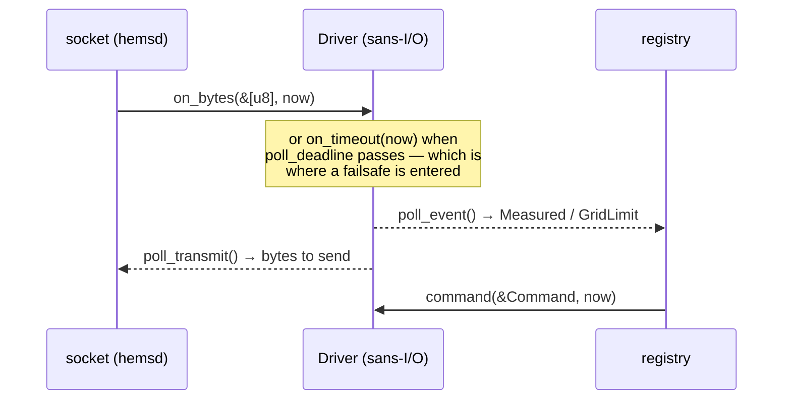

# ems-drv

Protocol adapters for the EMS edge systems. The caller supplies bytes and timestamps, handles socket I/O and sends outgoing frames. Device drivers report measurements and capabilities. Grid drivers report limits to the guard.

| Feature | Purpose |
|---|---|
| `mbus` | Read one complete reply from the commissioned wired heat meter and decode exact cumulative thermal Wh with mbus-kit 0.2 |
| `modbus` | SunSpec and vendor register drivers, with read-only RTU framing for serial meters |
| `eebus` | SHIP/SPINE household and grid-control drivers |
| `ocpp` | Read OCPP 1.6J station inlet power and transaction-scoped outlet energy |
| `matter` | Map signed appliance power for the household gateway |

Read-only SunSpec units reject commands. Writable units rediscover their register map after reconnect and verify each inverter ceiling by readback. An explicitly managed virtual battery accepts bounded model 704 watt targets. Its register confirmation and measured AC power are separate observations.

For serial grid meters, `modbus::Meter` reads the common identity and verifies SunSpec model 203 before publishing signed power and import/export counters. The bus owner supplies one complete RTU reply at a time. `modbus::rtu::ReadRequest` verifies the unit, function, length and checksum before the driver sees the reading.

A commissioned Modbus wallbox can report cable presence, charge fraction, usable capacity and cumulative outlet Wh. Declare `command = "charging_amps"` only for a whole-ampere current register. The driver rounds down fractional ceilings and checks the address and count in the write reply.

See the [device guide](https://hupe1980.github.io/ems/docs/devices/) for driver registration, command delivery and measurement freshness.

## License

MIT OR Apache-2.0
