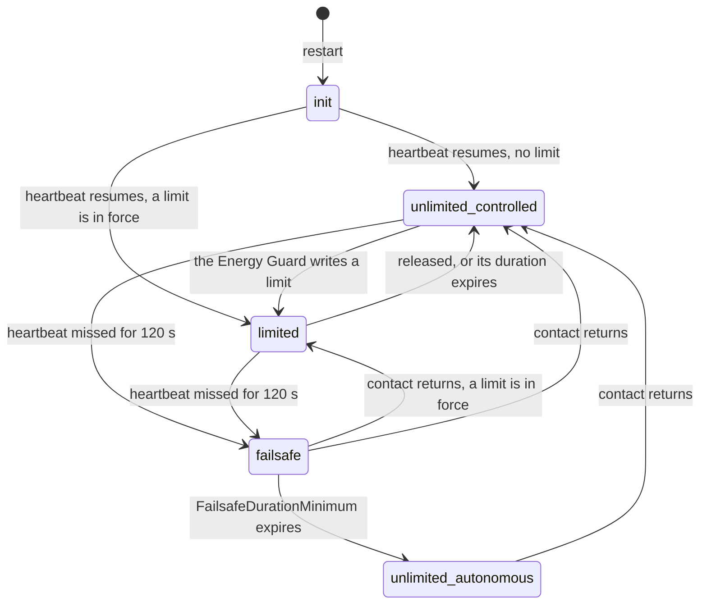

# ems-grid

The German grid rules for a home energy system — **executable, cited and tested**.

Every rule names its source. `[A1 4.5.2]` is Anlage 1 to BNetzA decision
BK6-22-300; `[LPC-031]` is the EEBUS *Limitation of Power Consumption* use-case
specification. A rule without a citation is a bug.

| What | Where it comes from |
|---|---|
| Which devices are steuerbare Verbrauchseinrichtungen, and the per-Fallgruppe summation | `[A1 2.4]` |
| Participation and the transitional regimes to 2028 | `[A1 3.1]`, `[A1 10]` |
| The minimum power a network operator may not go below, with the Gleichzeitigkeitsfaktor table | `[A1 4.5]` |
| The five-state EEBUS LPC/LPP machine: heartbeat, failsafe, release | EEBUS LPC TS §§ 2.2–2.3 |
| The § 9 EEG 60 % cap, what lifts it, and the EEBUS feed-in factor | § 9 Abs. 1–2 EEG (Solarspitzengesetz), `[MGCP-011]` |
| Modul 3 HT/NT/ST windows and their validity rules | BDEW AWH Modul 3 V1.1 |
| The two-year evidence record, with every commanded ceiling | `[A1 7]` |
| Which period MiSpeL governs for a household — effect date, month-start switch, Rumpfmonat/Rumpfjahr, consent, state aid — over `metering`'s Anlage 1 and 2 arithmetic | MiSpeL (BNetzA 618-25-02, 01.10.2026), Tenorziffern 8–9 |
| Allocating an energy-sharing community's generation | § 42c EnWG Abs. 1, 3, 4 |

The EEBUS limitation machine, which is how a § 14a limit reaches the house:



After restart the state machine retains a limitation under `[LPC-901/1]`. If the peer stays silent, the minimum failsafe duration eventually permits the autonomous state under `[LPC-922]`.

§ 14a limits the controllable devices’ demand from the grid. § 9 EEG limits the net export measured at the connection point. `site_feed_in_ceiling` accounts for on-site consumption when converting the export limit into a device ceiling.

The rule engine takes time and measurements as inputs. Settlement quantities use decimal arithmetic. The control loop uses floating-point power. [Metering primitives](https://github.com/hupe1980/metering)

```rust
use ems_grid::para14a::{ControlMode, SteuVe, minimum_power};
use ems_core::prelude::{AssetId, Fallgruppe, Power};

let devices = [
    SteuVe { assets: vec![AssetId::new("wallbox")?], fallgruppe: Fallgruppe::Ladepunkt, power: Power::from_kw(11.0) },
    SteuVe { assets: vec![AssetId::new("battery")?], fallgruppe: Fallgruppe::Stromspeicher, power: Power::from_kw(5.0) },
];
// 4,2 kW + (2 − 1) × 0,8 × 4,2 kW = 7,56 kW
assert!((minimum_power(&devices, ControlMode::Ems).kw() - 7.56).abs() < 1e-9);
# Ok::<(), Box<dyn std::error::Error>>(())
```

## Use it

```console
$ cargo add ems-grid
```

API reference on [docs.rs](https://docs.rs/ems-grid); the design is explained in
[The grid rules](https://hupe1980.github.io/ems/docs/grid-rules/).

## License

MIT OR Apache-2.0
