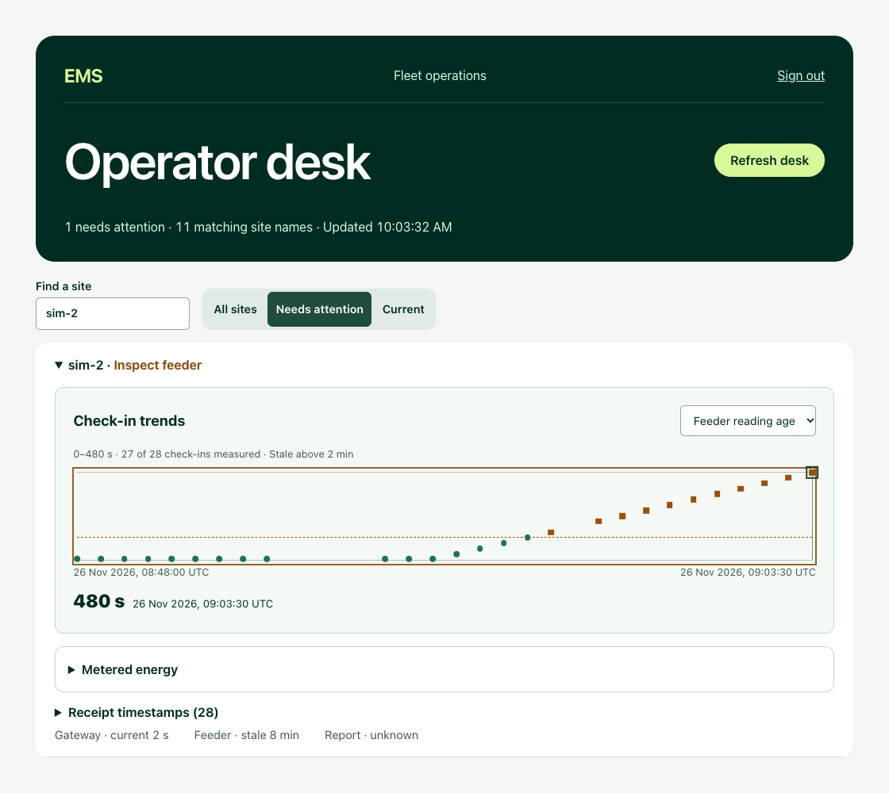

# fleetd

Fleet enrolment, configuration and release manifests. An installer provisions a single-use enrolment secret. A client exchanges it for a site credential and reports the configuration version it runs.

The service distributes Ed25519 signatures created by an external signer. Install household configuration and updates through the installer or operating system. [Configuration example](fleetd.example.toml)

| Route | Result |
|---|---|
| `POST /v1/enrol` | single-use enrolment |
| `GET /v1/config` | the signed configuration for this box |
| `POST /v1/config/running` | which version it is actually running |
| `GET /v1/releases/{component}` | a signed release manifest |
| `GET /v1/fleet` | what the fleet is enrolled on |

## Operator desk

Open `/desk` through the [OIDC ingress](../../deploy/oidc/README.md). Filter to **Needs attention** or search by site. The desk shows 15 sites per page, prioritized by condition. Search, status and page survive reload and browser Back. Expand a site to plot up to 32 check-ins against their UTC send times. Switch between feeder reading age, report age and delivery delay. Select a point or focus the plot and use the arrow keys for its exact value. Open **Receipt timestamps** for the source readings.

Open **Metered energy** and choose 1, 7, 30 or 90 days ending on a Berlin date. Drag to zoom or jump to a peak or gap. Use the arrow keys for exact import and export in kWh. **Open meter day** shows the underlying quarter-hour table. **Return to range** restores your zoom and selected quarter. [Historian route on the OIDC ingress](../../deploy/oidc/README.md).



The desk ships inside `fleetd`. After editing the chart or its Tailwind styles in `web/portal/desk`, run `just portal-build` and rebuild the binary.

Gateways post to `/v1/checkins` with their site bearer. Send `sent_at` every 30 seconds, with optional `feeder_at` and `report_at` in Unix seconds. Synchronize the gateway clock. The fleet accepts sends up to 90 seconds old and ignores duplicates or out-of-order sends. Omit an observation when its time is unknown. A closure is reported by the gateway.

To rehearse a stalled feeder, set `FLEET_SITE_TOKEN` to an enrolled simulator's credential and run:

```sh
python3 xtask/fleet_checkin.py http://127.0.0.1:7180 --stalled-feeder --count 3
```

Refresh the desk during the rehearsal. Gateway contact stays current while the feeder reading ages. After the simulator stops, the gateway becomes silent once receipt age exceeds 90 seconds. Feeder readings age out after 120 seconds and report closures after 36 hours. `GET /v1/desk` returns `rows`, `page` (zero-based), `page_size`, `total`, `attention` and `matched`. Search with `q` and select `filter=all|attention|current`. Counts cover authorized names matching the search. `matched` also applies the status filter. For a rehearsal, pass `filter=cohort&run=ID`. Add `?site=SITE` for one site’s receipt history.

## Rehearse a gateway update

Run `just canary-trial` to freeze 100 simulated sites, verify a signed candidate and restart a disposable gateway. The desk distinguishes a rejected signature or digest, wrong target, rollback, stale readiness and a qualified build. Select **Rehearsal cohort** to search the original membership after new sites enroll. Open **Build and readiness evidence** to see the candidate and reported running digests. Read one run with `GET /v1/desk/canary?run=ID` using the operator grant.

## License

MIT OR Apache-2.0
