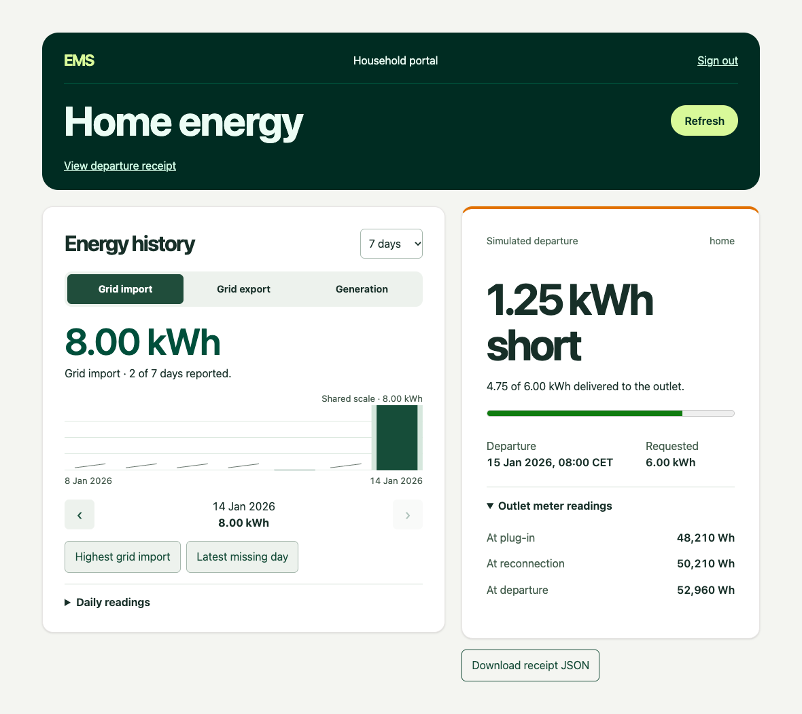

# portald

Compare import, export and generation over 7 or 30 calendar days ending on the latest report. Jump to the highest reported day or latest gap. All three measures use the same vertical scale for the selected period. Open the daily readings for exact kWh, or inspect the simulated charging receipt and its outlet registers.



## Run locally

From the workspace root, build the React app and Tailwind styles with Node 26 and npm, then start the Rust service.

```sh
just portal-build
cargo run --locked -p portald -- --config services/portald/portald.example.toml
```

Open `/portal` through the [OIDC ingress](../../deploy/oidc/README.md). The portal service reads from `obsd` on port 7780 using the server-side grant for the signed-in household.

## Rehearse a departure

Set `EMS_OBSD_SECRET` to the simulator household’s signing key, then run:

```sh
cargo run -p hemsd --features house -- ev-departure --goal-wh 6000 --missing-close --report-to http://127.0.0.1:7780
```

View the receipt, repeat the command without `--missing-close`, and refresh. A closing register replaces the unverified outcome with measured delivery. Use a second configured site for a different goal at the same fixture deadline.

Run `just portal-trial` for the automated browser rehearsal with Docker, Chromium and uv. It also checks revocation between viewing and downloading.

## Develop and deploy

For a local preview, run `npm --prefix web/portal run dev:fixtures`. Set `EMS_PORTAL_FIXTURE` to `met`, `short`, `partial` or `empty` before starting Vite to choose the simulated departure. The preview includes synthetic daily energy reports.

Deploy the binary with `web/portal/dist` and set `assets_dir` and `collector_origin`. Both customer endpoints, `/v1/me/history` and `/v1/me/departure`, derive the site from the credential on each request.

## License

MIT OR Apache-2.0
